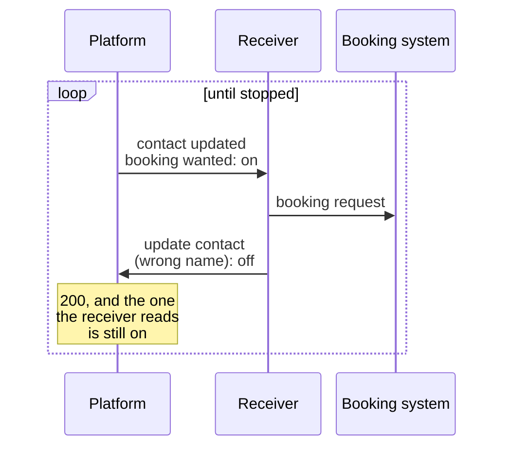
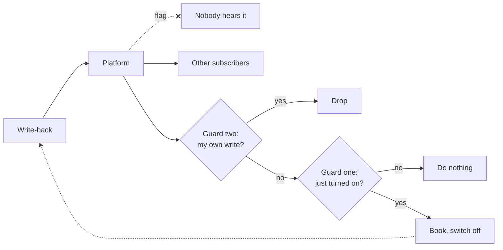

# Webhook loops

I was testing a new webhook receiver in a test environment,
with its logs open, when the same contact came through again. Then again. The invocation count kept
climbing while I watched, and I stopped the function.

The receiver's job was simple. The platform sends a webhook when a contact
is updated. If an attribute on the contact says a booking is wanted, the
receiver sends a booking request to another system, then writes back to
the contact: the details it filled in, and the attribute switched off, so
each request is booked once.

The write-back is a contact update. So the platform sent a webhook for it,
and the receiver heard its own write and checked the attribute. It should
have been off. But the receiver checked it under one name, and the
write-back switched it off under another. The platform accepted the write and
answered success. The attribute the receiver read was still on, so it
booked again, wrote back again, and heard itself again.

No booking went out. The receiver checks more than the attribute before it
books, and I had set the test contact up so that it would never pass: I
was testing each part on its own, and wanted to see the write-back work
before anything was booked. But on a
contact that did pass, every lap would have been a booking request, and a
booking isn't a write you can repeat for free.
[Webhooks: sync or queue](/notes/webhooks-sync-or-queue/) leaned on
receivers whose writes are safe to repeat. This one's isn't.

The fix has two parts. Debugging the loop turned up the mix-up, and the
switch-off now uses the name the receiver reads. And the receiver now writes back with a flag
the platform offers, which tells it not to send a webhook for that write at
all. Either guard would stop the loop on its own. We kept both, because
the first had just failed without a sound.

That is what this post is about. When processing a webhook writes back to
a system that sends webhooks, your own write is an event too, and your
receiver will hear it. Act on the change that asked for the work, and have
your write switch it off. That guard runs through someone else's API and
can fail quietly, so add a second: drop the events the payload says you
caused, or have the platform not send them, as long as nobody else needs
to hear the change. Then test with the logs open, because for a loop like
this one, nothing else is going to stop it.

It picks up where [Webhooks: sync or queue](/notes/webhooks-sync-or-queue/)
ended: the work is done, and it wrote something back.

## Your write is an event too

A platform sends a webhook for a change without asking who made it. An
agent edits a contact, an import touches a thousand, another app syncs a
field, your receiver writes back: each is a contact update, and every
subscriber hears about it. Usually that is the point. It stops being the
point when one of the subscribers is the receiver that made the write.

The platforms that document this describe the same circle. Slack's
[Deno SDK](https://docs.slack.dev/tools/deno-slack-sdk/guides/creating-event-triggers/)
warns that an app answering every message in a channel will answer its
own answers too: "it'll keep posting messages forever!"

So the question to ask at design time is short: for each write the
receiver makes, which webhooks will it fire, and does the receiver
subscribe to any of them? Ours had the answer in one line of the design.
It listens for contact updates, and it updates contacts. The circle can
also be wider than one platform: you write to one system, it syncs to
another, and that one notifies you. Each hop is someone's reasonable
design. The loop is what they add up to.

A loop through a receiver that only upserts, like those in
[Webhooks: sync or queue](/notes/webhooks-sync-or-queue/), burns
invocations and changes nothing. One with a side effect, a message, a
charge or a booking, repeats it every lap. That is the one to design for.

## Guard one: act on the change, and switch it off

Our receiver's first guard was the attribute itself, and the shape of the
rule is what matters. "Book while the attribute is on" is a rule about a
state. It runs again for every event that still carries that state, and an
echo of your own write carries whatever your write didn't change. "Book
when the attribute turns on" is a rule about a change. It runs once.

Some payloads let you see the change. Stripe's `*.updated` events carry
[`previous_attributes`](https://docs.stripe.com/api/events/object), the
values "prior to the event". Many carry only the current state, ours
included. Then the receiver gets there another way: it switches the attribute off once
the work is done, so the next "on" is a new request and an echo finds it
off.

This guard has costs, and ours paid the last one:

- **The echo still arrives.** The guard decides what the receiver does,
  not whether it is called. Every write-back still costs a delivery and an
  invocation that ends up doing nothing.
- **The switch-off is a write to someone else's system.** You send it, the
  request succeeds, and you assume it landed. Ours didn't: it switched off
  an attribute under a name the receiver didn't read, and the platform
  took it without complaint. Nothing on our side could see that until the
  loop did.
- **It wasn't built as a loop guard.** The switch-off was there for the
  business: one booking per request. That it also stopped loops was a
  side effect nobody tested, and a guard nobody knows they rely on fails
  quietly. If yours does double duty, test the second duty too: write
  back, read the record, and check the attribute is really off.

## Guard two: know your own writes, or don't hear them

The second guard has to break the loop without depending on the first.
It can sit in the receiver, which recognises its own write and drops it,
or in the platform, which doesn't send it.

**Recognising your own writes** is easy where an app is the obvious
author. [Meta](https://developers.facebook.com/documentation/business-messaging/messenger-platform/webhooks/webhook-events/message-echoes)
marks a message your page sent with `is_echo`, and `app_id` says which
app sent it. Slack sets
[`bot_id`](https://docs.slack.dev/reference/events/message/bot_message/)
on a bot's messages, and its
[Bolt framework for Python](https://docs.slack.dev/tools/bolt-python/reference/app/app.html)
skips your own bot's events by default, which its docs call "useful for
avoiding code error causing an infinite loop".

Elsewhere it takes work, or a leap. Stripe puts the ID of the API request
that caused an event in
[`request.id`](https://docs.stripe.com/api/events/object), and returns the
same ID in a [`Request-Id`](https://docs.stripe.com/api/request_ids)
header on your call, so you could keep the IDs of your own writes and drop
events that match. That is my reading of the two fields; Stripe doesn't
describe it. Shopify's webhook
[headers](https://shopify.dev/docs/apps/build/webhooks/delivery-structure)
name the shop, the topic and the event, but none says which app made the
change, and the docs I read don't say whether your app hears its own
updates. Check what your platform's payload actually says before you
build on it.

**Not hearing it at all** is cheaper still: no delivery, no invocation,
nothing to drop. The flag on our write-back tells the platform not to
send a webhook for it, to anyone, and that is its cost. Ours is safe
because the write-back only touches fields that nothing else uses. Before
you reach for a flag like it, ask who else subscribes, and whether any of
them, now or later, needs to hear about this write.

Most platforms don't offer one. Then the payload is your second guard,
and where it says nothing either, you have guard one alone, or a record
of your own writes to check each event against: a store the receiver
didn't need before.

## Nothing else will stop it

AWS Lambda has [recursive loop
detection](https://docs.aws.amazon.com/lambda/latest/dg/invocation-recursion.html),
on by default: "If your function is invoked approximately 16 times in the
same chain of requests, then Lambda automatically stops the next function
invocation in that request chain and notifies you." It sounds like the
net under this whole post. Then read which loops it means: "Lambda
currently detects recursive loops between your functions, Amazon SQS,
Amazon S3, Amazon SNS, and Amazon EventBridge Custom event buses."

Our loop went from the function, over HTTP to the platform's API, and back
as a webhook through API Gateway. That path isn't on the list. AWS doesn't
say it can't catch it; it lists what it can, and a round trip through
someone else's platform isn't there. Even for the loops it does catch,
the email "can take up to 3.5 hours" to arrive.

None of the other webhook docs I read describe a limit on loops that go
through their API and your receiver. As far as they say, the loop runs until something on your side
stops it.

So the net is the first test, and it is worth setting up on purpose:

- **Test the write-back against the real platform.** A mock of its API
  won't send the webhook back, so the loop can't show up.
- **Keep the side effect off**, as the opening's test contact did: the
  loop ran and nothing was booked.
- **Watch it run.** The logs and the invocation count are what showed me
  the loop: the same contact, over and over, faster than any person
  updates one.
- **Know how you will stop it** before you start, because when it starts,
  every lap is another request.

## Before the first write-back

The receiver from the opening still runs with both guards: the attribute
switches off after a booking, and the write-back asks the platform not to
send a webhook for it. Neither is clever. What it took was asking a few
questions before the first write went out, instead of after the loop
answered them:

- **Which of your writes come back to you?** A write can be an event to
  anyone subscribed. Find the ones your receiver subscribes to, directly
  or through another system.
- **Does the work start on a change, or on a state?** A state is still
  there in the echo. A change isn't, as long as your write switches it off
  and the switch-off lands.
- **Does the payload say who made the change?** Then drop your own. If
  it doesn't, don't guess.
- **Can the platform leave you out, and who else would miss it?** A flag
  that silences the write silences it for everyone.
- **What stops it if both guards fail?** Probably nothing but you,
  watching, so watch the first run.

That is the last of what I set out to write about receiving webhooks.
[Webhooks are not API calls](/notes/webhooks-are-not-api-calls/) was about
the request: a contract someone else wrote.
[Webhooks: sync or queue](/notes/webhooks-sync-or-queue/) was about when to
do the work. This one is about what the work writes back. Each came down to
the same habit: find out what this platform and this job actually do,
before the general answer decides for you.
